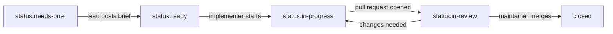

# AGENTS.md

Rules for every coding agent working in this repository: Claude Code (cloud or pointed at a local model), GitHub Copilot, and any other tool that reads `AGENTS.md`. Human contributors follow the same rules; see [CONTRIBUTING.md](CONTRIBUTING.md).

This file is the single source of agent rules. Tool-specific files ([CLAUDE.md](CLAUDE.md), [.github/copilot-instructions.md](.github/copilot-instructions.md)) only point here and add what is specific to that tool. Change the rules here, by pull request.

## What this is

Linux Hello is a session credential broker for the Linux desktop. The user unlocks once with face, fingerprint or PIN; passkeys then work in browsers, native and Electron apps through the credentialsd portal; a routing policy decides per relying party whether a key is device-bound (TPM) or portable (KeePassXC).

The maintainer (@atterdag) owns the architecture, the threat model and every merge, and reviews **behaviour, tests and test results**, not Rust. Write code that can be trusted without being read: the tests and their names are the review surface.

| Path | Container | C4 element in `workspace.dsl` |
| :-- | :-- | :-- |
| `crates/linuxhello-dbus` | Shared D-Bus names and types; the only coupling between containers | component `dbusApi` |
| `crates/linuxhello-agent` | Agent: unlock and auth state, routing policy, PIN, enrolment, reset | container `agent` |
| `crates/pam-linuxhello` | PAM module: parallel face, fingerprint and PIN | container `pamModule` |
| `crates/linuxhello-tpm-provider` | credentialsd provider for device-bound passkeys | container `tpmProvider` |
| `crates/linuxhello-kpxc-bridge` | credentialsd provider for portable passkeys from KeePassXC | container `kpxcBridge` |
| `crates/linuxhello-ctl` | CLI | container `cli` |
| `plasma/`, `security/`, `policy/` | Plasma integration; AppArmor, Tetragon, alerts; policy schema | `plasma`, `secProfiles`, `policyStore` |
| `docs/` | Obsidian vault: architecture, ADRs, spikes, threat model, security properties | — |

## Roles and workflow

Roles are fixed by [ADR-0004](docs/adr/0004-agent-roles.md). Know which one you are playing.

| Role | Agent | Does | Does not |
| :-- | :-- | :-- | :-- |
| **Implementer** | Local model via Claude Code | Implements one issue from its brief: tests first, then code; runs `make fix` and `make gates`; opens a pull request | Pick issues without a brief; change scope; touch files the brief does not list; edit `docs/adr/` or CI |
| **Lead** | Claude | Writes briefs; keeps labels, milestones and `docs/` current; reviews and fixes pull requests, pushing to their branches; opens pull requests; runs spikes | Merge; push to `main`; tag or release; change repository settings; sign off a commit |
| **Assistant** | GitHub Copilot | Pull request summaries; commit messages for hand-made commits; review comments with suggested changes | Push commits unless the maintainer asks it to |
| **Maintainer** | @atterdag | Decides and merges | — |

### Issue status

Each issue carries one `status:` label; the lead moves it.



Spikes skip the implementer: the lead takes them from `status:needs-brief` to `status:in-review` directly.

Every open issue also carries exactly one `priority:` label (`now`, `next`, `later`), and dependencies are GitHub *blocked by* links, not prose. The next issue in a lane is the one with the highest priority and no open blocker, lowest number first; `make next` shows it. The lead keeps `make backlog-check` clean. Details: [The backlog](docs/project/backlog.md).

### The brief

The lead posts the brief as an issue comment headed `## Implementation brief`. It must fit a small context window, so it is self-contained:

1. **Goal**: one sentence of behaviour.
2. **Files**: the exact files to create or change (at most five).
3. **Properties and tests first**: the security properties involved and the test names to write before the code.
4. **Constraints**: the invariants and ADRs that apply, quoted, not referenced.
5. **Acceptance**: the exact commands that must pass.
6. **Out of scope**: what not to touch.

A task that needs more than about 300 changed lines or five files is split into several issues.

### Review

The lead reviews every pull request against its brief before the maintainer sees it:

- the brief's tests exist, are named after their property and fail without the change;
- no invariant is broken; no new `unsafe`; no new dependency without a reason;
- the gates pass when run locally (`make gates`), not just in CI;
- the `quality-gate` check passed, which means its attestation for the commit the gates tested (GitHub's merge commit of the pull request) exists and verifies; recheck with `scripts/ci/verify-quality-gate.sh <merge-sha> refs/pull/<n>/merge` when in doubt, taking the SHA from the job's predicate;
- the description follows the template: intent, process mapping, acceptance criteria met, each criterion with its proof;
- docs changed with the code.

Small faults the lead fixes by pushing to the pull request branch; larger ones go back to the implementer with a review comment. Copilot's review and the code scanners are a second opinion, not a substitute.

### Copilot suggestions and the DCO

Every commit needs the maintainer's sign-off, including commits that apply a Copilot suggestion.

- **"Commit suggestion"** on a review comment creates a commit authored by the maintainer through the web interface; the organisation requires sign-off on web commits, so it passes the `dco` check.
- **Commits pushed by the lead** through the Claude GitHub App carry no sign-off either; the maintainer certifies them before merge with `dco-signoff.sh <pr>`, as for the Copilot coding agent below.
- **Changes made by the Copilot coding agent** (for example "Fix with Copilot" or `@copilot`) are authored by a bot and carry no sign-off. The maintainer reviews them and certifies them before merging with `dco-signoff.sh <pr>`, which adds his sign-off and re-signs the branch with his commit-signing key. The script lives in the maintainer's private workstation repository (`scripts/dco-signoff.sh`), not in this one, and runs on his machine.

## Source of truth

Resolve conflicts in this order, and say which source you used:

1. `main`: code, tests, CI results
2. Accepted ADRs in [docs/adr/](docs/adr/)
3. The architecture documentation in [docs/architecture/](docs/architecture/README.md), structured by Arc42 ([ADR-0010](docs/adr/0010-arc42-architecture-documentation.md)), and `docs/architecture/workspace.dsl`
4. Upstream documentation and source (credentialsd, libwebauthn, Howdy, fprintd, KeePassXC, tss-esapi, zbus, KDE) at the version in `Cargo.lock`

Upstream behaviour you have not checked in source or docs is an assumption. Say so.

## Invariants

Never propose or write anything that breaks these. If a task seems to need it, stop and say so.

1. **The PIN is the root.** Keys hang off a TPM root key authorised by the PIN. Biometrics only satisfy a TPM policy; they are never the root and never a flag in a daemon.
2. **Keys sign, never leave.** Private key material never leaves the TPM or KeePassXC. The Secret Service stores tokens, never passkey private keys.
3. **Fail closed.** Unparseable policy denies everything except the PIN. A daemon whose AppArmor profile is not loaded in enforce mode refuses to start. No fallback silently weakens authentication.
4. **No `unsafe`**, except in one small, audited module each in the TPM provider and the PAM module. The workspace denies `unsafe_code`; every other crate root sets `#![forbid(unsafe_code)]`. A module may carry `#[allow(unsafe_code)]` only if it is listed in `scripts/ci/unsafe-allowlist.txt`, and adding it needs the maintainer's review. The `unsafe-policy` CI job enforces this.
5. **Licence boundaries.** Link only to LGPL or permissive code. Reach GPL components (KeePassXC, fprintd) across a process boundary only. All code here is LGPL-3.0-or-later ([ADR-0002](docs/adr/0002-licence-lgpl-3-or-later.md)).
6. **Upstream first.** Changes to upstream projects go upstream as contributions, not into forks or vendored patches.
7. **One-way doors need an ADR:** licence, names, D-Bus names (`io.github.LinuxHello.*`), crate and package names, the reset model ([ADR-0003](docs/adr/0003-destructive-reset.md)), repository topology.
8. **Public repository.** Never write secrets, tokens, personal data, or details of anyone's machines (hostnames, home paths, hardware, local endpoints, model names) into code, docs, issues, commit messages or PR descriptions.
9. **No secrets in the loop.** Never ask for, read, print or store a token or key. The lead works in GitHub through the Claude GitHub App, whose credential the session injects unseen ([ADR-0004](docs/adr/0004-agent-roles.md#amendment-2026-11-03-the-lead-works-in-github-directly)); every other GitHub operation runs through `gh` on the maintainer's machine. Produce scripts, not requests for credentials.

## How to work

- **Spikes before code.** Milestone 0 answers the unverified assumptions in `docs/spikes/`. Do not write implementation that depends on an open spike; name the spike that blocks it.
- **Security properties first.** Every security behaviour is a plain-language property in `docs/security/` with a test whose name states it, e.g. `caller_from_other_origin_is_refused`. Write the property and the failing test before the code.
- **Small PRs, one container where possible.** Each PR states intent, affected containers, tests added, how to verify, and rollback.
- **Document every item, and name its C4 element.** See [Code documentation](#code-documentation).
- **Docs change with code.** A behaviour change updates the architecture note, the C4 workspace or an ADR in the same PR. Flag drift when you see it.
- **Check versions before trusting an API.** credentialsd is pre-release; tss-esapi, zbus, cxx-qt and the PAM crates change between versions. Read `Cargo.lock`, then the docs for that version.
- **Automate.** Prefer Makefile targets and scripts that check their own prerequisites over sequences of manual commands. Scripts are idempotent and fail closed.
- **Dependencies** must pass `cargo-deny` (licences, advisories, sources). Do not add one to work around a missing feature without saying why.

## Gates

CI runs these on every pull request; all are required. After writing code, run `make fix` (rustfmt, then clippy's machine-applicable fixes) and fix what remains by hand. Then run `make gates`, which runs exactly the CI gates, before you squash, push or call a change done:

```sh
cargo fmt --all --check
cargo clippy --workspace --all-targets -- -D warnings
cargo test --workspace
cargo deny check
cargo audit
bash scripts/ci/unsafe-policy.sh
scripts/ci/fuzz.sh 60          # every cargo-fuzz target, 60 s each, pinned nightly
RUSTDOCFLAGS="-D warnings" cargo doc --workspace --no-deps --document-private-items
bash scripts/ci/test-c4-docs.sh && bash scripts/ci/c4-docs.sh   # C4 tags (ADR-0008)
```

The `quality-gate` check passes only when all of these passed. It then signs a Sigstore attestation for the commit ([ADR-0006](docs/adr/0006-attested-quality-gates-and-releases.md)). The gate list is [`scripts/ci/quality-gates.txt`](scripts/ci/quality-gates.txt), and `make verify-gate SHA=<commit>` checks the attestation for a commit on `main`.

CI also runs CodeQL (security), dependency review (new vulnerable or disallowed dependencies) and SonarQube Cloud (code quality and coverage). Treat their findings like a failing test: fix the cause, or explain in the pull request why it is a false positive.

**Fuzzing.** Every parser of untrusted or admin-supplied input has a cargo-fuzz target in its crate's `fuzz/` directory, seeded with inputs near the limits it checks, and the `fuzz` gate runs it. A crash the fuzzer finds also gets a unit test named after the property it breaks. Never weaken, skip or bypass a gate, a lint level or a test to get green; fix the cause or stop and report it.

**Report results honestly.** Mark every change *tested* or *untested*, with the toolchain version and the exact command. "Compiles" is not "tested". A test you did not run did not pass.

## Code documentation

Every item is documented, and the code names the C4 element it implements ([ADR-0008](docs/adr/0008-code-documentation-mapped-to-c4.md)). Clippy and the `docs` gate enforce it.

| C4 level | Rust | Rule |
| :-- | :-- | :-- |
| 1 System context | — | `docs/architecture/workspace.dsl` and [Arc42 section 3](docs/architecture/03-context-and-scope.md); never in code |
| 2 Container | crate | The crate root (`lib.rs`, `main.rs`) opens with `//!` docs: what the container does, then ``//! C4 container: `<id>` `` |
| 3 Component | module declared in the crate root | Its own file, opening with `//!` docs: responsibility, collaborators, then ``//! C4 component: `<id>` ``, a component of the crate's container |
| 4 Code | nested modules, structs, enums, traits, fields, variants, functions, methods, constants | `///` on every one, private ones included |

`<id>` is the identifier in `workspace.dsl`. A new top-level module needs its component in `workspace.dsl` first; add it in the same pull request. Diagrams stay in `workspace.dsl`; do not draw C4 diagrams in doc comments.

What a doc comment says:

- **Types and fields:** what the value means and its valid range or states, in the terms of the architecture notes (for policy, the words of `policy-semantics.md`).
- **Functions:** what it does and what it refuses. Add `# Errors` when it returns `Result`, `# Panics` when it can panic, `# Safety` on an `unsafe fn`, and a `// SAFETY:` comment on every `unsafe` block.
- **Security-relevant code:** the property it upholds, by the name of its test in `docs/security/`.
- Not the obvious (`/// Returns the value.`), not the history of the change, no superlatives.

Test code is exempt: a test's name is its documentation.

## Commits and pull requests

- `main` is protected: branch, open a pull request, squash merge. Never push to `main`.
- The pull request description has exactly the three sections of the [template](.github/pull_request_template.md), and it becomes the squash commit message:
  1. **Intent**: the goal and the behaviour achieved, not a list of functions or parameters changed.
  2. **Process mapping**: the containers, ADRs, architecture notes, security properties and brief the change implements or relies on, linked.
  3. **Acceptance criteria met**: every criterion from the brief as a checklist item with its proof (the test that states it, or the command and its result), then the tests, how to verify and the gates.
- Every commit carries `Signed-off-by:` (`git commit -s`) from the human who submits it, certifying the [DCO](https://developercertificate.org/). An agent runs `git commit -s` only in a session that human started and with that human's git identity; it never adds a sign-off for anyone else.
- Commits on `main` are signed.
- Name the tool that produced a substantial part of a change with a trailer, one per tool:

  ```text
  Assisted-by: Claude Code (claude-opus-5-5)
  Assisted-by: GitHub Copilot
  Assisted-by: Claude Code with a local model
  ```

  Name a local model by family and size at most; never by host or endpoint (invariant 8).

## Documentation (`docs/`)

- Frontmatter on every note: `type`, `subject`, `artifact`, `status`, `owner`, `concepts`, `tags`, `sources`, `date`. Templates in [docs/templates/](docs/templates/).
- Standard relative Markdown links, never `[[wikilinks]]`, so notes render on GitHub and in Obsidian.
- Diagrams in Mermaid; C4 in Structurizr DSL (`docs/architecture/workspace.dsl`).
- ADRs: Title, Status, Context, Decision, Consequences (what becomes easier and what becomes harder).
- No preamble, closing offers or unfalsifiable superlatives ("bulletproof", "fully secure").

## Communication

Lead with the answer or diagnosis. Put commands in code blocks with one line on what each touches. Say what you verified and what you assumed. Disagree when the evidence says so, including with the architecture and with the maintainer. Ask one sharp question when a request is ambiguous.
