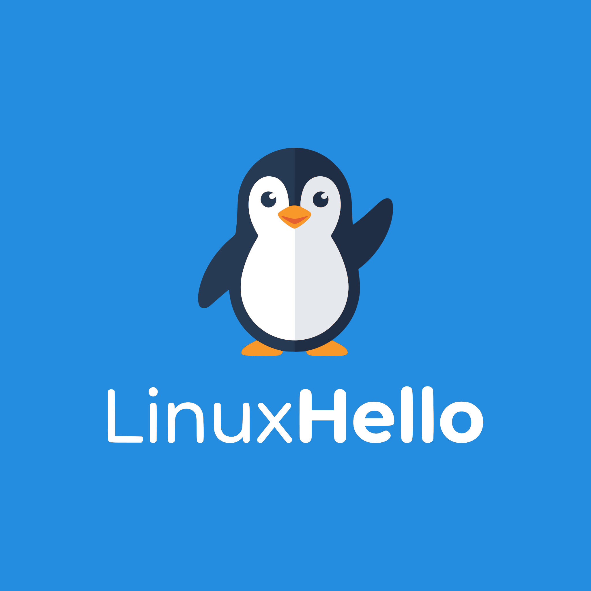

<p align="center">
  
</p>

# Linux Hello

[](https://sonarcloud.io/summary/new_code?id=LinuxHello_linux-hello)
[](https://sonarcloud.io/summary/new_code?id=LinuxHello_linux-hello)

PIN-rooted, biometric-unlocked passkeys and secrets for the Linux desktop: a Windows Hello equivalent built as an integration layer on a virtual CTAP authenticator (a `uhid` device that browsers see as a security key), fprintd, Howdy, KeePassXC and TPM 2.0 ([ADR-0005](https://github.com/LinuxHello/linux-hello-architecture/blob/main/adr/0005-provider-path.md)).

Homepage: [linuxhello.github.io](https://linuxhello.github.io/).

**Status:** pre-alpha. There are no releases and no external audit, so do not use it to protect real accounts. It is no longer only a design: a first prototype unlocks `sudo` with a PIN or a fingerprint.

- **Built and tested:**
  - the Agent, the system service at the centre: the state API on the system bus ([ADR-0014](https://github.com/LinuxHello/linux-hello-architecture/blob/main/adr/0014-agent-bus.md)) with its bus policy, systemd unit and AppArmor profile, checked on a real bus under an enforcing profile on Ubuntu 24.04 and 26.04; the routing policy engine and each user's policy layer ([ADR-0018](https://github.com/LinuxHello/linux-hello-architecture/blob/main/adr/0018-user-policy-layer.md)); the PIN, stretched with Argon2id and checked by the TPM, with a lockout per user ([ADR-0021](https://github.com/LinuxHello/linux-hello-architecture/blob/main/adr/0021-pin-transport.md)); the fingerprint method through fprintd and the face method through Howdy; the status interface ([ADR-0024](https://github.com/LinuxHello/linux-hello-architecture/blob/main/adr/0024-agent-status-interface.md)); audit records; and the reset after a forgotten PIN ([ADR-0027](https://github.com/LinuxHello/linux-hello-architecture/blob/main/adr/0027-settings-page-calls.md));
  - the TPM provider, the one program that talks to the TPM: it makes a user's root key, checks a PIN against it and changes the PIN in place. It is tested on a software TPM; a hardware TPM is not tested yet;
  - the PAM module, which asks the Agent in `sudo`, at the login screen, at the lock screen and when a session is unlocked, and leaves the account password in charge when Linux Hello is not there ([ADR-0023](https://github.com/LinuxHello/linux-hello-architecture/blob/main/adr/0023-pam-module-and-login-failure.md)), and `linuxhello-ctl`, which sets and changes the PIN and shows the state;
  - the Plasma parts: the Agent Link, the Auth Prompt and Linux Hello's own login screen for greetd, tested in a desktop test VM.
- **Prototyped, not in this repository:** the virtual CTAP authenticator, which created and used TPM-backed credentials with libfido2, Chromium and Firefox in a test VM ([spike 0094](https://github.com/LinuxHello/linux-hello-architecture/blob/main/spikes/0094-virtual-ctap-end-to-end.md)).
- **Try it:** a first prototype unlocks `sudo` (and, if you choose, the Plasma lock screen) with a PIN kept by the TPM or a fingerprint; [docs/prototype.md](docs/prototype.md) says how to install it, try it and remove it.
- **Not built yet:** passkeys in the browser through the virtual security key (the KeePassXC bridge is a stub), the page in Plasma's System Settings, and tests on a hardware TPM.
- **Reviewed, not audited:** an AI-assisted review of the architecture and the code on 22 November 2026 found one high, twelve medium and nineteen low findings. Most of the fixes are merged or in review, and [the status of each finding](https://linuxhello.github.io/security-review.html#fixes) is public. It is not an independent audit; none has been done.
- **Next:** passkeys in the browser through the virtual security key, and the Plasma prompt on the lock screen. The [spikes](https://github.com/LinuxHello/linux-hello-architecture/blob/main/spikes/README.md) of Milestone 0 are mostly answered; the open ones are listed in the backlog.

## What it is

- One session credential broker: unlock once with face, fingerprint or PIN, and passkeys work in browsers, native apps and Electron apps.
- PIN as the root of trust (TPM2 authorisation on a per-user root key), biometrics as a shortcut, account password as a destructive reset.
- Per relying party custody: device-bound (TPM) or portable (KeePassXC), set by policy.
- KDE Plasma first: one prompt that shows which method is active, the same on the login manager, lock screen and in-session.

## Layout

| Path | Container |
| :-- | :-- |
| `crates/linuxhello-dbus` | Shared D-Bus interface names and types |
| `crates/linuxhello-agent` | Agent: unlock state, auth state, routing policy, PIN, enrolment, reset |
| `crates/pam-linuxhello` | PAM module: parallel face, fingerprint and PIN |
| `crates/linuxhello-tpm-provider` | Device-bound passkeys: TPM keys behind the virtual CTAP authenticator |
| `crates/linuxhello-kpxc-bridge` | Portable passkeys from KeePassXC, behind the virtual CTAP authenticator |
| `crates/linuxhello-ctl` | CLI |
| `plasma/` | Prompts, greeter integration, enrolment, settings |
| `security/` | The Agent's bus policy, systemd unit and AppArmor profile; Tetragon policies and alert rules later |
| `policy/` | Policy schema and examples |
| `docs/` | Obsidian vault (open `docs/` as a vault); renders on GitHub. Start at [docs/index.md](docs/index.md) |
| `architecture/` | Submodule: [`LinuxHello/linux-hello-architecture`](https://github.com/LinuxHello/linux-hello-architecture), the Arc42 sections, the C4 model (`workspace.dsl`), the architecture decision records and the Milestone 0 spikes |
| `docs/security/`, `docs/architecture/policy-semantics.md` | Threat model and security properties; policy semantics |

The virtual CTAP authenticator and its `uhid` helper are not crates yet.

## Build

### Prerequisites

On Ubuntu or Kubuntu 24.04 and later, install a C toolchain and rustup from the distribution, then the stable Rust toolchain:

```sh
sudo apt install curl build-essential rustup   # system packages: C compiler and linker, rustup
rustup default stable                          # a default toolchain for cargo tools outside this repository
```

Inside the repository, `rust-toolchain.toml` pins the Rust version and components; rustup installs them on the first `cargo` command. The minimum supported Rust version is in `Cargo.toml` (`rust-version`). For the supply-chain checks that CI runs, install the two cargo tools once:

```sh
cargo install --locked cargo-deny cargo-audit   # into ~/.cargo/bin
```

### Build and test

Clone with the architecture submodule, which the `docs` gate checks the code against:

```sh
git clone --recurse-submodules https://github.com/LinuxHello/linux-hello.git
```

In an existing clone, run `git submodule update --init`.

```sh
cargo build --workspace
cargo test --workspace
```

Before opening a pull request, run every gate CI runs; the list is in [AGENTS.md](AGENTS.md#gates).

## Licence

LGPL-3.0-or-later. See [COPYING.LESSER](COPYING.LESSER) and [COPYING](COPYING).

## Contributing and security

To find something to work on, run `make next` or read [the backlog](docs/project/backlog.md). See [CONTRIBUTING.md](CONTRIBUTING.md), [GOVERNANCE.md](GOVERNANCE.md) and [SECURITY.md](SECURITY.md). Report vulnerabilities privately, never in a public issue.
