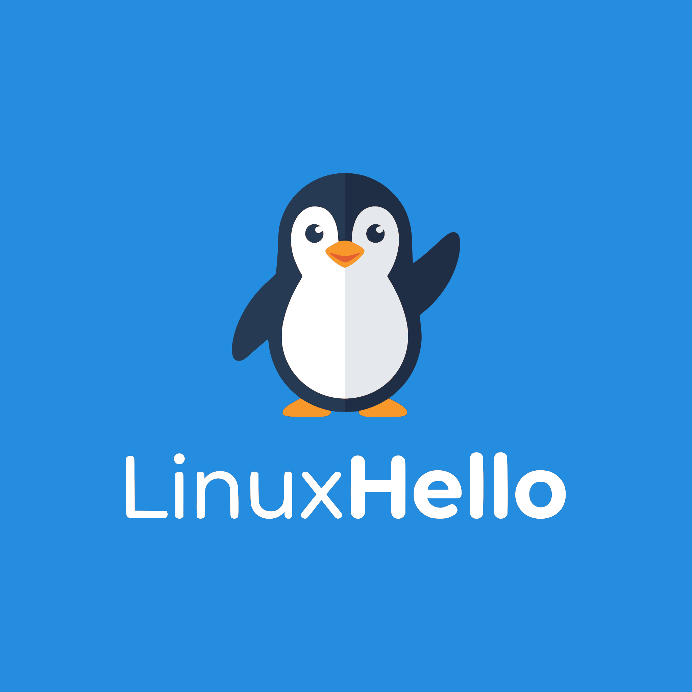

<p align="center">
  
</p>

# Linux Hello

PIN-rooted, biometric-unlocked passkeys and secrets for the Linux desktop: a Windows Hello equivalent built as an integration layer on [credentialsd](https://github.com/linux-credentials/credentialsd), fprintd, Howdy, KeePassXC and TPM 2.0.

**Status:** pre-alpha. Nothing here authenticates anyone yet. Milestone 0 (spikes) runs before any implementation.

## What it is

- One session credential broker: unlock once with face, fingerprint or PIN, and passkeys work in browsers, native apps and Electron apps.
- PIN as the root of trust (TPM2 authorisation on a per-user root key), biometrics as a shortcut, account password as a destructive reset.
- Per relying party custody: device-bound (TPM) or portable (KeePassXC), set by policy.
- KDE Plasma first: one prompt that shows which method is active, the same on the login manager, lock screen and in-session.

## Layout

| Path | Container |
| :-- | :-- |
| `crates/linuxhello-dbus` | Shared D-Bus interface names and types |
| `crates/linuxhello-agent` | Agent: unlock state, auth state, routing policy, PIN, enrolment, reset |
| `crates/pam-linuxhello` | PAM module: parallel face, fingerprint and PIN |
| `crates/linuxhello-tpm-provider` | credentialsd provider for device-bound passkeys |
| `crates/linuxhello-kpxc-bridge` | credentialsd provider for portable passkeys from KeePassXC |
| `crates/linuxhello-ctl` | CLI |
| `plasma/` | Prompts, greeter integration, enrolment, settings |
| `security/` | AppArmor profiles, Tetragon policies, alert rules |
| `policy/` | Policy schema and examples |
| `docs/` | Obsidian vault (open `docs/` as a vault); renders on GitHub. Start at [docs/index.md](docs/index.md) |
| `architecture/` | Submodule: [`LinuxHello/architecture`](https://github.com/LinuxHello/architecture), the Arc42 sections, the C4 model (`workspace.dsl`), the architecture decision records and the Milestone 0 spikes |
| `docs/security/`, `docs/architecture/policy-semantics.md` | Threat model and security properties; policy semantics |

## Build

### Prerequisites

On Ubuntu or Kubuntu 24.04 and later, install a C toolchain and rustup from the distribution, then the stable Rust toolchain:

```sh
sudo apt install curl build-essential rustup   # system packages: C compiler and linker, rustup
rustup default stable                          # a default toolchain for cargo tools outside this repository
```

Inside the repository, `rust-toolchain.toml` pins the Rust version and components; rustup installs them on the first `cargo` command. The minimum supported Rust version is in `Cargo.toml` (`rust-version`). For the supply-chain checks that CI runs, install the two cargo tools once:

```sh
cargo install --locked cargo-deny cargo-audit   # into ~/.cargo/bin
```

### Build and test

Clone with the architecture submodule, which the `docs` gate checks the code against:

```sh
git clone --recurse-submodules https://github.com/LinuxHello/linux-hello.git
```

In an existing clone, run `git submodule update --init`.

```sh
cargo build --workspace
cargo test --workspace
```

Before opening a pull request, run every gate CI runs; the list is in [AGENTS.md](AGENTS.md#gates).

## Licence

LGPL-3.0-or-later. See [COPYING.LESSER](COPYING.LESSER) and [COPYING](COPYING).

## Contributing and security

To find something to work on, run `make next` or read [the backlog](docs/project/backlog.md). See [CONTRIBUTING.md](CONTRIBUTING.md), [GOVERNANCE.md](GOVERNANCE.md) and [SECURITY.md](SECURITY.md). Report vulnerabilities privately, never in a public issue.
