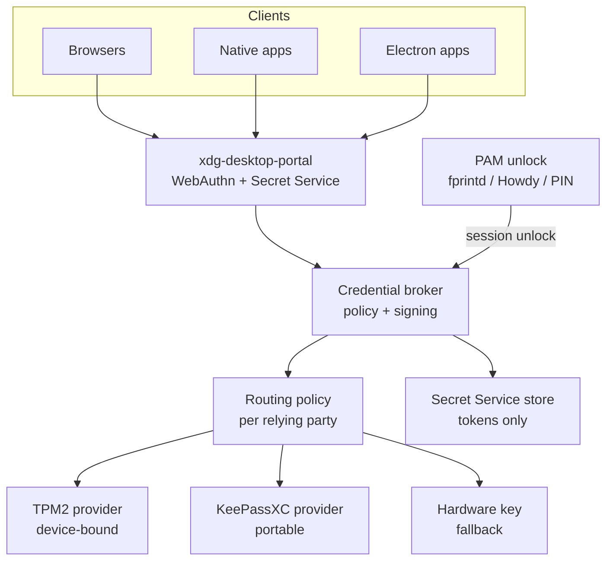

# 4. Solution strategy

Part of the [Arc42 architecture documentation](README.md).

## Layers

| Layer | Responsibility | Candidate components |
| :-- | :-- | :-- |
| 1. Unlock | One biometric/PIN verification per session; re-prompt per policy | PAM, `fprintd`, Howdy, PIN |
| 2. Broker | Single policy point; signs WebAuthn assertions; never exports private keys | credentialsd (Linux Credentials project) |
| 3. Interfaces | WebAuthn/CTAP2 API and Secret Service API on D-Bus, via xdg-desktop-portal | Portal backend for KDE |
| 4. Routing policy | Per context and relying party: methods, provider, prompt level | Declarative policy files |
| 5. Providers | Hold keys | TPM2 (device-bound), KeePassXC (portable/synced), hardware security key (fallback) |

## Diagram

## Design rules

1. **Keys sign; stores keep secrets.** Passkey private keys stay in the TPM or KeePassXC and are used by the broker to sign. The Secret Service holds only resulting tokens, never passkey private keys.
2. **Unlock gates use, never release.** Biometric verification unlocks a key's use. It never hands key material to a caller.
3. **Operator chooses custody.** The routing policy decides TPM vs KeePassXC per relying party; the default for high-value accounts is TPM.
4. **One path for all clients.** Browsers, native and Electron apps use the same portal. The browser-extension path is a transitional fallback, and it is the only browser path until Firefox and Chromium call the portal ([spike 0006](../spikes/0006-browser-webauthn-portal.md): neither does in current source).
5. **Short token lifetimes are respected.** The aim is invisible reissue, not longer tokens.

## Token reissue (the Claude Desktop case)

- **Target:** Device Bound Session Credentials (W3C draft DBSC, piloted in Chrome). A TPM-bound key proves the device, and short-lived tokens are refreshed silently. Requires provider support.
- **Interim:** keep the browser re-login, but make it one touch. The OAuth login page asks for a passkey, the broker signs after one fingerprint, and the token lands in the Secret Service.

## Prior art (checked 2026-10-27)

Build on credentialsd rather than writing a new broker. It already covers layers 2–4; the gaps are the TPM provider, a KeePassXC provider, the biometric gate and a KDE portal backend.

| Project | What it does | State | Fit |
| :-- | :-- | :-- | :-- |
| [Credentials for Linux](https://github.com/linux-credentials) — libwebauthn + [credentialsd](https://github.com/linux-credentials/credentialsd) | FIDO2 platform library; D-Bus credentials portal for apps (third-party provider API planned, not in v0.3.1, see spike 0005); reference GTK UI; Firefox add-on and patched Flatpak | v0.3.1 pre-release (7 Sep 2026); needs a patched xdg-desktop-portal; TPM provider planned, not built; packaged for Fedora/openSUSE | Layers 2–4. Adopt |
| [kpasskey](https://github.com/Tojori/kpasskey) | Passkeys stored in KWallet, exposed as a virtual CTAP 2.1 security key to unmodified Firefox and Chromium | Prototype | KDE-native interim path; software keys, browsers only |
| tpm-fido | Virtual USB FIDO device backed by the TPM | Not re-checked in this pass | TPM custody without a portal |
| KeePassXC (≥ 2.7.7) | Passkeys in KDBX via browser extension | Released | Portable provider, once a credentialsd provider API exists (ADR-0005) |

Sources: [FOSDEM 2026 talk](https://archive.fosdem.org/2026/schedule/event/838A8N-credentials-for-linux-bringing-passkeys-to-linux/), [slides](https://archive.fosdem.org/2026/events/attachments/838A8N-credentials-for-linux-bringing-passkeys-to-linux/slides/267430/fosdem_ravbuub.pdf), [freedom-browser issue #733](https://github.com/solardev-xyz/freedom-browser/issues/733). Taken from search snippets; repositories not yet opened.

## Alternatives

| Option | Pros | Cons |
| :-- | :-- | :-- |
| **Session broker + portal on credentialsd (recommended)** | Covers all clients; one unlock; per-RP custody choice; reuses upstream CTAP/WebAuthn work | Upstream is pre-release; portal and provider work needed |
| KeePassXC + browser extension only | Works today; portable keys | Browsers only; software keys; master-password unlock |
| tpm-fido (virtual USB FIDO device on TPM) | Works with any CTAP client today; TPM-bound | Hack-level UX; no biometric gate by default; no portable keys |
| Hardware security key only | Mature, strongest custody | Separate device; no biometric unlock; no sync |

## Consequences

**Easier:** one unlock for passkeys and secrets; device-bound keys for high-value accounts; native and Electron apps join the passkey flow; enterprise-style policy (PIN complexity, allowed methods per context); a clean path to DBSC.

**Harder:** a new trust-critical daemon to operate, confine and monitor; policy must be maintained per context and relying party; TPM-bound keys are lost if the TPM is cleared or the root key is reset (ADR-0003); upstream contributions to credentialsd, Howdy and plasma-desktop are on the critical path; portal support in KDE and browsers is immature.
