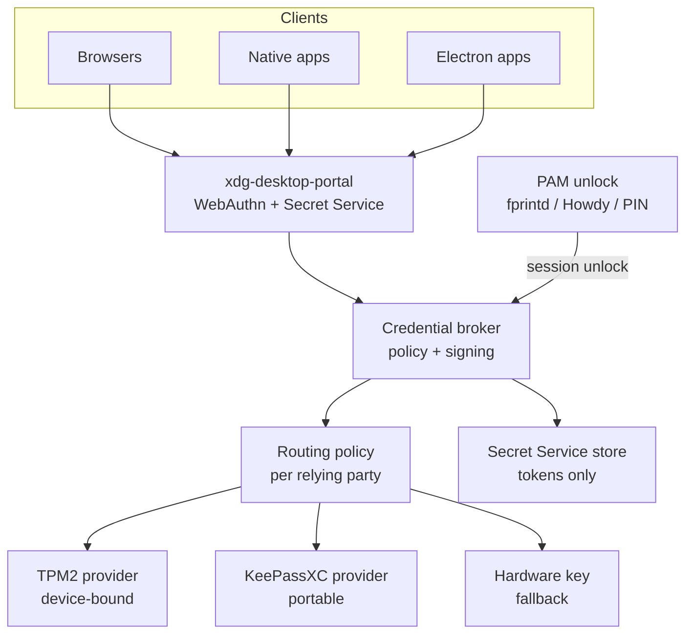

# Linux Hello — Target Architecture

## Recommendation

Build one **session credential broker** for the whole desktop, not a browser feature. It is unlocked once by biometrics through PAM, serves passkeys (WebAuthn/CTAP2) and secrets (Secret Service API) to browsers, native apps and Electron apps over an xdg-desktop-portal, and routes each relying party to a key provider by policy: TPM2 (device-bound) or KeePassXC (portable). Build it as an integration layer on credentialsd, not a reimplementation.

## Situation

Windows Hello combines three layers: TPM-held non-exportable keys, local user verification (biometric or PIN) that only unlocks those keys, and an OS platform-authenticator API (`webauthn.dll`) that browsers and apps call. Third-party providers (1Password, others) plug in beside it.

## Complication

Linux has the first two layers and lacks the third.

- TPM2: available (`tpm2-tss`); many systems already use TPM2/PCR 7 for LUKS.
- User verification: `fprintd` (fingerprint), Howdy (face), both via PAM.
- Platform authenticator: **none system-wide.** Each browser implements WebAuthn itself and mostly talks only to roaming USB/HID authenticators.
- KeePassXC (≥ 2.7.7) stores passkeys, but serves them only through its browser extension, so native apps are not covered. Its keys are software keys unlocked by the master password.
- Native and Electron apps (e.g. Claude Desktop) re-authenticate through the browser when their token expires. KWallet is open on the reference machine; the observed cause is a server-side token lifetime under 24 h, which no client store can extend.

## Resolution: target architecture

### Layers

| Layer | Responsibility | Candidate components |
| :-- | :-- | :-- |
| 1. Unlock | One biometric/PIN verification per session; re-prompt per policy | PAM, `fprintd`, Howdy, PIN |
| 2. Broker | Single policy point; signs WebAuthn assertions; never exports private keys | credentialsd (Linux Credentials project) |
| 3. Interfaces | WebAuthn/CTAP2 API and Secret Service API on D-Bus, via xdg-desktop-portal | Portal backend for KDE |
| 4. Routing policy | Per context and relying party: methods, provider, prompt level | Declarative policy files |
| 5. Providers | Hold keys | TPM2 (device-bound), KeePassXC (portable/synced), hardware security key (fallback) |

### Diagram



### Design rules

1. **Keys sign; stores keep secrets.** Passkey private keys stay in the TPM or KeePassXC and are used by the broker to sign. The Secret Service holds only resulting tokens, never passkey private keys.
2. **Unlock gates use, never release.** Biometric verification unlocks a key's use. It never hands key material to a caller.
3. **Operator chooses custody.** The routing policy decides TPM vs KeePassXC per relying party; the default for high-value accounts is TPM.
4. **One path for all clients.** Browsers, native and Electron apps use the same portal. The browser-extension path is a transitional fallback.
5. **Short token lifetimes are respected.** The aim is invisible reissue, not longer tokens.

### Constraints

| ID | Constraint | Rationale |
| :-- | :-- | :-- |
| C1 | Linux Hello is an integration layer: it reuses credentialsd, libwebauthn, KeePassXC, fprintd and Howdy and adds only providers, unlock policy, the KDE portal backend and settings UI. **credentialsd v0.3.1 has no provider API** ([spike 0005](../spikes/0005-credentialsd-provider-api.md)); how providers attach is decided in [ADR-0005](../adr/0005-provider-path.md) | No reimplementation of existing upstream work |
| C2 | Link only to LGPL (or permissive) libraries, e.g. libwebauthn, credentialsd | LGPL permits linking from code under any licence |
| C3 | Reach GPL components only across a process boundary (D-Bus, PAM, socket, KeePassXC browser protocol), never by linking | FSF treats linking as creating a derivative work; separate programs are not |
| C4 | Modifications to an upstream component go upstream as contributions, not into a private fork | Keeps LGPL/GPL obligations trivial and the ecosystem shared |
| C5 | Linux Hello itself is LGPL-3.0-or-later ([ADR-0002](../adr/0002-licence-lgpl-3-or-later.md)) | Compatible with credentialsd (LGPL-3.0-only) and other LGPL dependencies |

Licences: credentialsd **LGPL-3.0-only** (verified in `credentialsd/Cargo.toml` at v0.3.1, spike 0005). To verify before publishing (from search snippets or general knowledge, not checked): libwebauthn unverified; KeePassXC GPL; fprintd GPL; Howdy MIT. Scoping-stage assessment, not legal advice.

### Token reissue (the Claude Desktop case)

- **Target:** Device Bound Session Credentials (W3C draft DBSC, piloted in Chrome). A TPM-bound key proves the device, and short-lived tokens are refreshed silently. Requires provider support.
- **Interim:** keep the browser re-login, but make it one touch. The OAuth login page asks for a passkey, the broker signs after one fingerprint, and the token lands in the Secret Service.

## Trust chain

The PIN is the root, biometrics are a shortcut, and the account password is a destructive reset. This follows the Windows Hello default.

| Tier | Linux Hello | Windows Hello parallel |
| :-- | :-- | :-- |
| Root | PIN = TPM2 authorisation on a per-user root key; every passkey key hangs off it; TPM anti-hammering limits guessing; PIN never leaves the device | PIN unlocks the TPM-protected Windows Hello container; TPM anti-hammering |
| Shortcut | fprintd / Howdy satisfy a TPM policy for the session; never the root; failure falls back to PIN | Windows Biometric Framework, templates local only; a match releases the container |
| Passkeys | Stored by the TPM provider, served by credentialsd | Stored in the Hello container, served by `webauthn.dll` |
| Reset | Account or admin password authorises destroying the root key and enrolling a new PIN; it never unlocks keys | "I forgot my PIN": re-authenticate with Microsoft/Entra account; default reset deletes the container |
| Recovery | Through relying parties: re-register passkeys with each service (account recovery, second credential) | Same; Entra's non-destructive PIN reset service is the exception |

### Decision LH-1: destructive reset, no recovery key

A reset wipes the root key and every TPM-bound passkey; there is no recovery key, and recovery goes through the relying parties. Recorded as [ADR-0003](../adr/0003-destructive-reset.md).

## User journeys

1. **Session login.** Face or fingerprint at the Plasma login manager or lock screen → PAM unlocks the session and the broker together; PIN on failure.
2. **Passkey sign-in in a browser.** Site calls WebAuthn → credentialsd → routing policy picks TPM or KeePassXC → signed silently, or after one touch for high-value relying parties.
3. **Native app re-auth (Claude Desktop).** Token expires → browser OAuth login → passkey assertion after one fingerprint → token stored in the Secret Service. Target: DBSC makes this invisible.
4. **Passkey enrolment.** Site offers passkey creation → policy, or the user, chooses device-bound (TPM) or portable (KeePassXC) → prompt to register a second credential for high-value accounts.
5. **Reset.** PIN forgotten or TPM cleared → account or admin password → root key and TPM-bound passkeys wiped → new PIN enrolled → user re-registers with each relying party, using the second credential or the service's account recovery.

## Security hardening

Write Linux Hello in Rust, and treat logic flaws as a bigger risk than memory bugs. The maintainer reviews behaviour rather than Rust code, so assurance has to come from behaviour tests, CI gates and outside reviewers.

### Language

Rust, matching credentialsd and libwebauthn (shared types and async stack). A long-running daemon that holds key material and parses input from untrusted callers is where memory safety matters most. Rust does not prevent logic flaws.

### Threats to design against

| Threat | Example | Mitigation |
| :-- | :-- | :-- |
| Caller impersonation | An app on D-Bus claims to be a browser, or asserts another site's origin | Verify the caller through the portal (sandbox app ID, peer credentials); never trust a caller-supplied origin from an unprivileged client |
| Unlock bypass | Biometric "match" accepted without the TPM policy actually being satisfied | Unlock state is enforced by the TPM policy session, never by a flag in the daemon |
| Key exfiltration | Private key material leaves the provider | TPM keys non-exportable; the broker only receives signatures |
| Silent use | A passkey signs without the user's knowledge | User-presence prompt rendered by the portal, outside the calling app |
| Parser exploit | Malformed CTAP/CBOR or D-Bus message | Fuzzing; no `unsafe` in parsers |
| Supply chain | Malicious or vulnerable crate | Pinned, audited dependencies |

### Controls

1. `#![forbid(unsafe_code)]` in every crate except one small, audited TPM FFI crate.
2. CI gates that block a merge: clippy (deny warnings), cargo-audit, cargo-deny (licences and advisories), fuzzing on every parser.
3. Each security property written in plain language and backed by a test whose name states it (e.g. "a caller from another origin is refused"). The operator reviews properties and test results, not code.
4. systemd sandboxing (dedicated user, `ProtectSystem=strict`, `NoNewPrivileges`, restricted address families, `DeviceAllow` for `/dev/tpmrm0` only) plus an AppArmor profile.
5. Providers contributed upstream to credentialsd so its maintainers review them.
6. External security audit of the TPM provider and broker before anyone relies on it.

### Runtime confinement and detection

**AppArmor (mandatory).** One profile per daemon and for `linuxhello-ctl`, shipped in **enforce** mode.

- Only the TPM Provider and the Agent may open `/dev/tpmrm0`; only the Face Client path may reach Howdy; only the Face Enrolment Module may open the camera.
- Policy files: admin layer read-only for every profile; user layer writable only by the Settings Module.
- Deny `ptrace` and `/proc/<pid>/mem` access to the Agent and providers.
- CI loads every profile (`apparmor_parser`), runs the property tests under them, and fails on any `DENIED` line or on a profile left in complain mode.

**Tetragon (optional, defence in depth).** Sample TracingPolicies shipped with the project; Linux Hello must not depend on them.

- Alert on any process other than the Agent or TPM Provider opening `/dev/tpmrm0`.
- Alert on writes to `/etc/linuxhello/policy.d/` or to the PAM stack files (`/etc/pam.d/*`).
- Sigkill on non-loopback network connects from any Linux Hello process (none of them needs the network).
- Alert on `ptrace` or `process_vm_readv` targeting the Agent or providers.
- Without BPF-LSM, kprobe tracing and Sigkill enforcement work today; BPF-LSM hooks need `bpf` added to the kernel's active LSM list.

CI check: the Tetragon policies are applied in a test VM and each alert is triggered once by a negative test.

**Rules.**

- Confinement fails closed: each unit checks that its AppArmor profile is loaded in enforce mode and refuses to start otherwise.
- Detection is only useful if watched: Tetragon events and the Agent's audit log are shipped to the log stack (e.g. Alloy → Loki → Grafana) with alert rules, not just written to disk.
- Enabling BPF-LSM is a kernel command-line (bootloader) change, documented per deployment.

Open question: who owns the threat model and the property list. Proposed: the maintainer, with tests written by Claude and reviewed upstream.

## User experience

At every prompt the user can see which method is active, switch to another, and enrol a method from a graphical wizard. This usability is what makes Windows Hello adoptable by ordinary users and enterprises, and it sets the bar.

### Requirements

| ID | Requirement | Surfaces |
| :-- | :-- | :-- |
| UX1 | The active method is always visible: face (camera live, scanning), fingerprint (touch sensor), PIN (field focused) | Login manager, lock screen, in-session prompts |
| UX2 | The user can switch method at any prompt ("Sign-in options"), with PIN always offered | All prompts |
| UX3 | Face and fingerprint run in parallel, first match wins; no sequential PAM timeouts | All prompts |
| UX4 | Clear failure feedback ("Face not recognised — try again or use PIN") and lockout state from the TPM ("PIN locked for N min") | All prompts |
| UX5 | Identical look and behaviour on the login manager, lock screen and in-session prompts | Plasma login manager, kscreenlocker, Prompt UI |
| UX6 | Face enrolment wizard: live camera preview, guided capture, an immediate recognition test, re-enrol and delete | System Settings |
| UX7 | Fingerprint enrolment reuses KDE's existing fingerprint UI in the Users settings page, linked from the same Linux Hello page | System Settings |
| UX8 | First-run wizard: PIN first (the root), then optional face and fingerprint | Enrolment Wizard |

**UX6a — Face enrolment preview.** The wizard shows the regular (RGB) camera feed as the user's view, while Howdy captures from the infrared (IR) sensor, as Windows Hello does. Rules:

- Guidance overlay (face found, too close, turn slightly, captured) is driven by Howdy's IR detection, never by the RGB image, so the feedback reflects what is actually enrolled.
- The RGB feed is display only: never stored, never passed to Howdy.
- No RGB camera present → show the IR feed in greyscale.
- Some cameras may not stream RGB and IR at once — **to test on real hardware**; fall back to IR preview if so.

**UX7a — One place for sign-in methods.** Face recognition sits beside fingerprint in KDE's Users settings page, where fingerprint enrolment already lives; KDE's fingerprint flow stays unchanged.

- Add a "Configure Face Recognition" entry next to the existing "Configure Fingerprint Authentication" entry, opening the Face Enrolment Module.
- Delivered as an upstream contribution to KDE's Users settings module (plasma-desktop), not a fork (C4). Whether that module offers an extension point is **unverified**; assumed not.
- Interim until accepted upstream: a separate Linux Hello page in System Settings, linked from the same area.

**UX7b — PIN management.** A "Change PIN" entry sits in the same area, beside fingerprint and face.

- Change PIN: enter the current PIN, then the new one twice. The TPM root key's authorisation value is changed in place, so passkeys survive (non-destructive).
- PIN rules shown up front (minimum length, digits only or alphanumeric) and checked as the user types.
- "I forgot my PIN" links to the destructive reset (ADR-0003), with a clear warning that device-bound passkeys will be wiped.
- Lockout state from the TPM is shown ("PIN locked for N min").

### Design consequence

A PAM conversation is text only, so a greeter cannot tell which method is running. Linux Hello therefore adds a side channel: `pam_linuxhello` runs fprintd and Howdy concurrently itself (instead of stacking `pam_fprintd` and `pam_howdy`) and publishes the live state on the Agent's D-Bus API (`MethodsAvailable`, `ActiveMethod`, `State`, `Result`). The login manager, lock screen and Prompt UI all render from that one state through a shared QML component.

### Additions to the C4 model

| Container | New component | Role |
| :-- | :-- | :-- |
| `pam_linuxhello` | Method Orchestrator | Runs face, fingerprint and PIN in parallel; first success wins; cancels the rest |
| Linux Hello Agent | Auth State Publisher | D-Bus signals for method, state and result per prompt |
| Plasma Integration | Auth Prompt QML Component | Shared method indicator and switcher for the greeter, lock screen and Prompt UI |
| Plasma Integration | Face Enrolment Module | Camera preview (PipeWire camera portal), guided capture and test; drives Howdy |
| Plasma Integration | Greeter and Lock Screen Integration | Embeds the shared component in the Plasma login manager and kscreenlocker |

New external dependencies: Howdy's enrolment and test interfaces (currently CLI only, so the module needs a stable interface; contribute one upstream if none exists), the camera via PipeWire, KDE's fingerprint enrolment UI. All of these are in the workspace DSL below.

Open questions: whether Howdy exposes a library or D-Bus interface usable for live preview — **unverified**; how the Plasma login manager and kscreenlocker allow a third-party prompt component — **unverified**.

## Policy

The Routing Policy Engine in the Agent answers one question before every credential operation: for this context, caller and relying party, which methods and provider are allowed, and how strong must the prompt be. It mirrors the Windows Hello for Business policy set (Group Policy / Intune) and adds per-context rules.

### How it is engaged

| Caller | Asks | Gets back |
| :-- | :-- | :-- |
| `pam_linuxhello` | Allowed methods for context `login`, `unlock`, `sudo`, … | Method set, factor count |
| TPM Provider / KeePassXC Bridge | Decision for relying party + operation (create, get) + verified caller app ID | Provider, prompt level (none, presence, re-verify), factors |
| Prompt UI / Auth Prompt | Which methods to offer and switch between | Method list, locked options |
| PIN Manager | PIN rules | Complexity rules, lockout threshold |
| Settings Module | Effective policy and which keys are admin-locked | Values + `managed` flags |

### Layers and precedence

1. Built-in defaults.
2. User layer `~/.config/linuxhello/policy.toml`, editable in Settings.
3. Admin layer `/etc/linuxhello/policy.d/*.toml` (root-owned, 0644). Any key set here wins and is shown greyed out as "Managed by your organisation". Later: delivered by a management system, as Intune does on Windows.

Most restrictive wins when two admin files conflict. The engine fails closed: a policy file that does not parse denies every operation except PIN.

### Settings

| Group | Setting | Windows Hello for Business parallel |
| :-- | :-- | :-- |
| PIN | `min_length`, `max_length` | Minimum / Maximum PIN length |
| PIN | `digits`, `lowercase`, `uppercase`, `special` (`required` / `allowed` / `disallowed`) | Digits, Lowercase, Uppercase, Special characters |
| PIN | `history`, `expiry_days` | History, Expiration |
| PIN | `lockout_attempts`, `lockout_minutes` (TPM dictionary-attack parameters) | TPM anti-hammering |
| Methods | `biometrics_allowed` | Allow use of biometrics |
| Methods | `face_requires_ir` (anti-spoofing) | Enhanced anti-spoofing |
| Methods | `require_hardware_tpm` | Use a hardware security device |
| Context | per context: `methods`, `factors`, `reverify_after` | No direct parallel (extension) |
| Relying party | per RP or RP class: `provider` (tpm / keepassxc / any), `prompt`, `require_second_credential` | No direct parallel (extension) |

### Example (admin layer)

```toml
[pin]
min_length = 6
digits = "required"
special = "allowed"
lockout_attempts = 5

[methods]
biometrics_allowed = true
face_requires_ir = true

[context.sudo]
methods = ["pin"]

[context.unlock]
methods = ["face", "fingerprint", "pin"]
reverify_after = "8h"

[rp_class.banking]
match = ["*.bank.example"]
provider = "tpm"
factors = 2          # e.g. fingerprint + PIN
require_second_credential = true
```

Schema is a draft; key names are proposals, **untested**.

## C4 model (Structurizr DSL)

Linux Hello is the only software system modelled inside; everything it reuses is an external software system, shown only by how Linux Hello consumes it. Levels: System Context, Container, and one Component view per container. Code level deferred until a Rust skeleton exists. DSL **untested**: validate with the Structurizr CLI before committing.

### Containers

| Container | Technology | Responsibility |
| :-- | :-- | :-- |
| Linux Hello Agent | Rust daemon, D-Bus (session) | Unlock state, auth state, routing policy, PIN, enrolment and reset orchestration |
| PAM module `pam_linuxhello` | Rust `cdylib` | Runs face, fingerprint and PIN in parallel; PIN verified against the TPM root key; reports state to the Agent |
| TPM Credential Provider | Rust daemon; attachment to credentialsd per ADR-0005 (no provider API at v0.3.1) | Creates and uses device-bound passkeys under the per-user TPM root key |
| KeePassXC Provider Bridge | Rust daemon; attachment to credentialsd per ADR-0005 (no provider API at v0.3.1) | Serves portable passkeys from KeePassXC over its browser protocol |
| Plasma Integration | Rust/cxx-qt, QML, KCM | Prompts, greeter and lock-screen integration, enrolment, PIN and settings |
| `linuxhello-ctl` | Rust CLI | Enrol, change PIN, reset trust chain (ADR-0003), inspect policy |
| User Policy | TOML (`~/.config/linuxhello/policy.toml`) | User layer of the policy |
| Admin Policy | TOML (`/etc/linuxhello/policy.d/*.toml`) | Admin layer; locked keys win |
| Security Profiles | AppArmor, Tetragon, alert rules | Confinement and detection shipped with Linux Hello |

### Workspace

```
workspace "Linux Hello" "Biometric- and PIN-gated passkeys and secrets for the Linux desktop" {

    model {
        user = person "Desktop user" "Signs in to the session, websites and apps; enrols methods"
        admin = person "Administrator" "Authorises a trust-chain reset"

        linuxHello = softwareSystem "Linux Hello" "PIN-rooted, biometric-unlocked credential layer integrating upstream Linux components" {

            agent = container "Linux Hello Agent" "Unlock state, auth state, routing policy, PIN, enrolment and reset orchestration" "Rust daemon, D-Bus" {
                dbusApi = component "D-Bus API" "io.github.LinuxHello.Agent1; verifies peer credentials of every caller" "zbus"
                unlockState = component "Unlock State Manager" "Session unlock, expiry and re-prompt rules; state proven by TPM policy sessions, not flags" "Rust"
                authState = component "Auth State Publisher" "Signals MethodsAvailable, ActiveMethod, State, Result per prompt (UX1-UX4)" "zbus signals"
                policyEngine = component "Routing Policy Engine" "Merges default, user and admin layers; answers allowed methods per context, provider and prompt level per relying party, PIN rules; fails closed on unparseable policy" "Rust"
                pinManager = component "PIN Manager" "Change PIN in place, PIN rules, lockout status (UX7b)" "Rust"
                enrolment = component "Enrolment Orchestrator" "First-run PIN, root key creation, second-credential prompts (UX8)" "Rust"
                resetCoord = component "Reset Coordinator" "Destructive reset per ADR-0003 (LH-1)" "Rust"
                auditLog = component "Audit Logger" "Structured journald events for every unlock, sign, PIN change and reset" "Rust"
            }

            pamModule = container "pam_linuxhello" "Parallel face, fingerprint and PIN authentication" "Rust cdylib, Linux-PAM" {
                pamEntry = component "PAM Entry Points" "pam_sm_authenticate and pam_sm_open_session" "Rust FFI"
                methodOrch = component "Method Orchestrator" "Runs face, fingerprint and PIN in parallel; first success wins; cancels the rest (UX3)" "Rust, async"
                pinVerifier = component "PIN Verifier" "Satisfies TPM2 auth on the root key; TPM anti-hammering applies" "Rust"
                faceClient = component "Face Client" "Requests a face match from Howdy" "Rust"
                fingerClient = component "Fingerprint Client" "Requests a verify from fprintd" "zbus"
                agentNotifier = component "Agent Notifier" "Reports method state and session unlock to the Agent" "zbus"
            }

            tpmProvider = container "TPM Credential Provider" "Device-bound passkeys under the per-user TPM root key" "Rust daemon, credentialsd Provider API" {
                tpmProviderApi = component "Provider API Adapter" "Implements the credentialsd provider interface" "zbus"
                credStore = component "Credential Index" "Maps relying party and credential ID to TPM key handles; no private material" "Rust"
                tpmKeys = component "TPM Key Service" "Root key, auth change, child keys, policy sessions, signing" "Rust"
                tpmFfi = component "TPM FFI" "The only crate allowed unsafe code" "tss-esapi"
            }

            kpxcBridge = container "KeePassXC Provider Bridge" "Portable passkeys from KeePassXC" "Rust daemon, credentialsd Provider API" {
                kpxcProviderApi = component "Provider API Adapter" "Implements the credentialsd provider interface" "zbus"
                kpxcClient = component "KeePassXC Protocol Client" "Encrypted browser-protocol channel to KeePassXC" "Rust, NaCl box"
            }

            plasma = container "Plasma Integration" "Prompts, greeter and lock-screen integration, enrolment and settings" "Rust/cxx-qt, QML, KCM" {
                authPrompt = component "Auth Prompt QML Component" "Shared method indicator and switcher; renders Agent auth state (UX1-UX5)" "QML"
                promptUi = component "Prompt UI" "In-session user-presence and provider-choice dialogs, outside the calling app" "QML, portal backend"
                greeterTheme = component "Greeter and Lock Screen Integration" "Embeds the shared prompt in the login manager and lock screen" "QML"
                kcm = component "Linux Hello Settings Module" "Interim settings page: methods, policy (UX7a)" "KCM, QML"
                faceEnrol = component "Face Enrolment Module" "RGB preview, IR-driven guidance overlay, capture, test, delete (UX6, UX6a)" "QML, Rust"
                pinSettings = component "PIN Settings" "Change PIN, rules, lockout status, forgot-PIN link (UX7b)" "QML"
                wizard = component "Enrolment Wizard" "First run: PIN, then optional face and fingerprint (UX8)" "QML"
                usersKcmPatch = component "Users Page Entries" "Face and PIN entries beside fingerprint; upstream contribution to plasma-desktop" "QML patch"
            }

            cli = container "linuxhello-ctl" "Enrol, change PIN, reset, inspect" "Rust CLI" {
                cliCommands = component "Command Parser" "enrol, pin change, reset, policy show" "clap"
                cliAgentClient = component "Agent Client" "Calls the Agent D-Bus API" "zbus"
            }

            policyStore = container "User Policy" "User layer: ~/.config/linuxhello/policy.toml" "TOML" "Data"
            adminPolicyStore = container "Admin Policy" "Admin layer: /etc/linuxhello/policy.d/*.toml, root-owned; locked keys win" "TOML" "Data"

            secProfiles = container "Security Profiles" "Confinement and detection shipped with Linux Hello" "AppArmor, Tetragon, alert rules" {
                aaProfiles = component "AppArmor Profiles" "One enforce profile per daemon and CLI; units refuse to start unconfined" "AppArmor"
                tetraPolicies = component "Tetragon TracingPolicies" "Optional: TPM access, policy and PAM writes, ptrace, network Sigkill" "Tetragon YAML"
                alertRules = component "Alert Rules" "Alerts on Tetragon events and audit log entries" "LogQL"
            }
        }

        credentialsd = softwareSystem "credentialsd" "Linux Credentials portal and broker (LGPL-3.0)" "External"
        portal = softwareSystem "xdg-desktop-portal" "Desktop portal framework" "External"
        keepassxc = softwareSystem "KeePassXC" "Password manager holding portable passkeys (GPL)" "External"
        fprintd = softwareSystem "fprintd" "Fingerprint daemon (GPL)" "External"
        howdy = softwareSystem "Howdy" "IR face recognition; match, enrol, test (MIT)" "External"
        linuxPam = softwareSystem "Linux-PAM" "Pluggable authentication framework" "External"
        tpm = softwareSystem "TPM 2.0" "Kernel resource manager /dev/tpmrm0" "External"
        camera = softwareSystem "Camera via PipeWire" "RGB feed for preview only" "External"
        secretService = softwareSystem "Secret Service (KWallet)" "Token and secret storage" "External"
        loginManager = softwareSystem "Plasma login manager" "Graphical login" "External"
        lockScreen = softwareSystem "kscreenlocker" "Plasma lock screen" "External"
        systemSettings = softwareSystem "KDE System Settings" "Hosts KCMs; Users page with fingerprint enrolment" "External"
        browsers = softwareSystem "Browsers" "Firefox, Chromium" "External"
        nativeApps = softwareSystem "Native and Electron apps" "e.g. Claude Desktop" "External"
        relyingParties = softwareSystem "Relying parties" "Websites and identity providers" "External"
        apparmor = softwareSystem "AppArmor" "Kernel LSM, mandatory access control" "External"
        tetragon = softwareSystem "Tetragon" "eBPF runtime security (optional)" "External"
        journald = softwareSystem "systemd-journald" "System log" "External"
        logStack = softwareSystem "Log stack" "e.g. Alloy, Loki, Grafana" "External"
        mgmt = softwareSystem "Device management" "Future: delivers admin policy, as Intune does" "External"

        # People
        user -> loginManager "Signs in"
        user -> lockScreen "Unlocks"
        user -> browsers "Signs in to websites"
        user -> nativeApps "Uses"
        user -> systemSettings "Manages sign-in methods"
        user -> promptUi "Confirms, switches method"
        user -> wizard "Enrols on first run"
        admin -> cliCommands "Authorises reset"

        # External to external (context only)
        browsers -> credentialsd "WebAuthn requests" "D-Bus portal"
        nativeApps -> credentialsd "WebAuthn requests" "D-Bus portal"
        nativeApps -> secretService "Stores tokens" "Secret Service API"
        browsers -> relyingParties "WebAuthn ceremonies" "HTTPS"
        credentialsd -> portal "Exposed through"
        loginManager -> linuxPam "Authenticates via"
        lockScreen -> linuxPam "Authenticates via"

        # KDE integration
        loginManager -> greeterTheme "Loads prompt" "QML"
        lockScreen -> greeterTheme "Loads prompt" "QML"
        greeterTheme -> authPrompt "Embeds"
        promptUi -> authPrompt "Embeds"
        authPrompt -> dbusApi "Subscribes to auth state, selects method" "D-Bus"
        systemSettings -> kcm "Hosts" "KCM"
        systemSettings -> usersKcmPatch "Shows entries on Users page"
        usersKcmPatch -> faceEnrol "Opens"
        usersKcmPatch -> pinSettings "Opens"
        kcm -> faceEnrol "Opens"
        kcm -> pinSettings "Opens"
        kcm -> dbusApi "Reads and writes settings" "D-Bus"
        kcm -> policyStore "Writes user policy" "TOML"
        wizard -> dbusApi "Starts enrolment" "D-Bus"
        wizard -> systemSettings "Hands off fingerprint enrolment to Users page"
        faceEnrol -> camera "Reads RGB preview (display only)" "PipeWire camera portal"
        faceEnrol -> howdy "Enrol, test, delete; IR detection events"
        pinSettings -> dbusApi "Change PIN, lockout status" "D-Bus"
        credentialsd -> promptUi "User-presence and choice prompts" "Portal backend"
        promptUi -> dbusApi "Reads routing decision, authenticates" "D-Bus"

        # PAM module
        linuxPam -> pamEntry "Loads module" "PAM stack"
        pamEntry -> methodOrch "Authenticate"
        methodOrch -> pinVerifier "PIN path"
        methodOrch -> faceClient "Face path"
        methodOrch -> fingerClient "Fingerprint path"
        methodOrch -> agentNotifier "Method state and result"
        pinVerifier -> tpm "TPM2 policy auth" "TCTI device"
        faceClient -> howdy "Match request"
        fingerClient -> fprintd "Verify" "D-Bus"
        agentNotifier -> dbusApi "Auth state, session unlocked" "D-Bus"

        # Agent
        dbusApi -> unlockState "Unlock queries"
        dbusApi -> authState "State updates"
        dbusApi -> policyEngine "Routing queries"
        dbusApi -> pinManager "PIN requests"
        dbusApi -> enrolment "Enrol requests"
        dbusApi -> resetCoord "Reset requests"
        policyEngine -> policyStore "Reads" "TOML"
        pinManager -> tpmKeys "Change root key auth" "D-Bus"
        enrolment -> tpmKeys "Create root key" "D-Bus"
        resetCoord -> tpmKeys "Destroy root key" "D-Bus"
        resetCoord -> linuxPam "Verifies account password" "PAM conversation"
        unlockState -> auditLog "Events"
        pinManager -> auditLog "Events"
        resetCoord -> auditLog "Events"

        # Providers
        credentialsd -> tpmProviderApi "Provider calls" "D-Bus"
        tpmProviderApi -> dbusApi "Checks unlock and policy" "D-Bus"
        tpmProviderApi -> credStore "Looks up credentials"
        tpmProviderApi -> tpmKeys "Sign assertion"
        tpmKeys -> tpmFfi "ESAPI calls"
        tpmFfi -> tpm "Commands" "/dev/tpmrm0"
        credentialsd -> kpxcProviderApi "Provider calls" "D-Bus"
        kpxcProviderApi -> dbusApi "Checks unlock and policy" "D-Bus"
        kpxcProviderApi -> kpxcClient "Get or create passkey"
        kpxcClient -> keepassxc "Browser protocol" "Unix socket"

        # Policy
        policyEngine -> adminPolicyStore "Reads; locked keys win" "TOML"
        pinManager -> policyEngine "PIN rules"
        methodOrch -> dbusApi "Allowed methods for context" "D-Bus"
        admin -> adminPolicyStore "Writes admin policy"
        mgmt -> adminPolicyStore "Delivers admin policy (future)"

        # Confinement and monitoring
        aaProfiles -> apparmor "Loaded into (enforce)"
        apparmor -> agent "Confines"
        apparmor -> tpmProvider "Confines"
        apparmor -> kpxcBridge "Confines"
        apparmor -> cli "Confines"
        tetraPolicies -> tetragon "Loaded into"
        tetragon -> logStack "Security events"
        auditLog -> journald "Audit events"
        journald -> logStack "Shipped by Alloy"
        alertRules -> logStack "Loaded into"

        # CLI
        cliCommands -> cliAgentClient "Invokes"
        cliAgentClient -> dbusApi "Calls" "D-Bus"
    }

    views {
        systemContext linuxHello "Context" {
            include *
            autoLayout lr
        }
        container linuxHello "Containers" {
            include *
            autoLayout lr
        }
        component agent "Agent" {
            include *
            autoLayout lr
        }
        component pamModule "PAM" {
            include *
            autoLayout lr
        }
        component tpmProvider "TPMProvider" {
            include *
            autoLayout lr
        }
        component kpxcBridge "KeePassXCBridge" {
            include *
            autoLayout lr
        }
        component plasma "Plasma" {
            include *
            autoLayout lr
        }
        component cli "CLI" {
            include *
            autoLayout lr
        }
        component secProfiles "SecurityProfiles" {
            include *
            autoLayout lr
        }
        styles {
            element "Person" {
                shape person
            }
            element "External" {
                background #999999
                color #ffffff
            }
            element "Data" {
                shape cylinder
            }
        }
    }
}
```

Code level (class diagrams): deferred until the Rust skeleton exists; first candidates are the Routing Policy Engine and the TPM Key Service.

## Prior art (checked 2026-10-27)

Build on credentialsd rather than writing a new broker. It already covers layers 2–4; the gaps are the TPM provider, a KeePassXC provider, the biometric gate and a KDE portal backend.

| Project | What it does | State | Fit |
| :-- | :-- | :-- | :-- |
| [Credentials for Linux](https://github.com/linux-credentials) — libwebauthn + [credentialsd](https://github.com/linux-credentials/credentialsd) | FIDO2 platform library; D-Bus credentials portal for apps (third-party provider API planned, not in v0.3.1, see spike 0005); reference GTK UI; Firefox add-on and patched Flatpak | v0.3.1 pre-release (7 Sep 2026); needs a patched xdg-desktop-portal; TPM provider planned, not built; packaged for Fedora/openSUSE | Layers 2–4. Adopt |
| [kpasskey](https://github.com/Tojori/kpasskey) | Passkeys stored in KWallet, exposed as a virtual CTAP 2.1 security key to unmodified Firefox and Chromium | Prototype | KDE-native interim path; software keys, browsers only |
| tpm-fido | Virtual USB FIDO device backed by the TPM | Not re-checked in this pass | TPM custody without a portal |
| KeePassXC (≥ 2.7.7) | Passkeys in KDBX via browser extension | Released | Portable provider, once a credentialsd provider API exists (ADR-0005) |

Sources: [FOSDEM 2026 talk](https://archive.fosdem.org/2026/schedule/event/838A8N-credentials-for-linux-bringing-passkeys-to-linux/), [slides](https://archive.fosdem.org/2026/events/attachments/838A8N-credentials-for-linux-bringing-passkeys-to-linux/slides/267430/fosdem_ravbuub.pdf), [freedom-browser issue #733](https://github.com/solardev-xyz/freedom-browser/issues/733). Taken from search snippets; repositories not yet opened.

## Alternatives

| Option | Pros | Cons |
| :-- | :-- | :-- |
| **Session broker + portal on credentialsd (recommended)** | Covers all clients; one unlock; per-RP custody choice; reuses upstream CTAP/WebAuthn work | Upstream is pre-release; portal and provider work needed |
| KeePassXC + browser extension only | Works today; portable keys | Browsers only; software keys; master-password unlock |
| tpm-fido (virtual USB FIDO device on TPM) | Works with any CTAP client today; TPM-bound | Hack-level UX; no biometric gate by default; no portable keys |
| Hardware security key only | Mature, strongest custody | Separate device; no biometric unlock; no sync |

## Consequences

**Easier:** one unlock for passkeys and secrets; device-bound keys for high-value accounts; native and Electron apps join the passkey flow; enterprise-style policy (PIN complexity, allowed methods per context); a clean path to DBSC.

**Harder:** a new trust-critical daemon to operate, confine and monitor; policy must be maintained per context and relying party; TPM-bound keys are lost if the TPM is cleared or the root key is reset (ADR-0003); upstream contributions to credentialsd, Howdy and plasma-desktop are on the critical path; portal support in KDE and browsers is immature.

## Open questions

- Maturity and API of credentialsd and its portal on KDE Plasma — [spike 0005](../spikes/0005-credentialsd-provider-api.md): v0.3.1 has **no third-party provider API** (upstream issue is a stub) and no KDE portal backend. Providers need upstream design work first; build and run untested.
- Whether Firefox and Chromium on Linux call a portal WebAuthn API today — **unverified**.
- Claude Desktop token lifetime and storage backend (KWallet vs libsecret) — observed by operator, not measured.
- Classification rule for which accounts must be device-bound — needs a data-classification rule.
- Who owns the threat model and the security property list.
