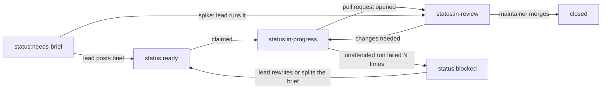

# The backlog

GitHub issues are the backlog. Labels and *blocked by* links on the issues are the only state; the [Roadmap board](https://github.com/orgs/LinuxHello/projects) and `make next` are views of them.

## What do I pick up next?

```sh
make next      # the top issue in each lane
make backlog   # every open issue, by lane, in pick-up order
```

Or open the **Next up** view on the Roadmap board. Both apply the same rule:

> **Next** = the open issue in your lane with the highest `priority:` label and no open *blocked by* link; on a tie, the lowest issue number.

`make next` and `make backlog` read GitHub with `gh` and change nothing (**tested** with a fake `gh`, `scripts/backlog/test-backlog.sh`, and read-only against the live repository on 2026-11-04).

## Lanes: who acts next

The `status:` label says who acts next on an issue.

| Lane | Label | Who acts | What they do |
| :-- | :-- | :-- | :-- |
| implement | `status:ready` | Implementer (agent or contributor) | Codes it from the `## Implementation brief` comment, tests first |
| brief | `status:needs-brief` | Lead | Writes the brief, then moves it to `status:ready` |
| spike | `status:needs-brief` + `type:spike` | Lead, or a contributor with the hardware | Runs the time-boxed spike and writes the note in `docs/spikes/` |
| review | `status:in-review` | Lead, then maintainer | Reviews against the brief; the maintainer merges |
| doing | `status:in-progress` | Whoever claimed it | — |
| stuck | `status:blocked` | Lead | Diagnoses a failed unattended run ([ADR-0007](../adr/0007-unattended-agent-loops.md)) |



## Labels every open issue carries

| Label | Values | Meaning |
| :-- | :-- | :-- |
| `status:` | exactly one, from the lanes above | Who acts next |
| `priority:` | `now`, `next` or `later`, exactly one | `now`: on the critical path of the current milestone. `next`: needed for the following step. `later`: parked until something changes |
| `container:` | one or more | Which crate or area it touches |
| `type:` | one | `feature`, `bug`, `security`, `spike`, `docs` |

Dependencies are GitHub's **blocked by** links (issue sidebar → *Relationships*), not prose. An issue with an open blocker waits, whatever its priority; `make backlog` shows what it waits for.

`make backlog-check` lists open issues that break these rules. The lead keeps it clean.

## Picking up an issue as a contributor

1. Run `make next`, or open **Next up** on the board, and take the top issue in the *implement* lane (or a spike whose hardware you have).
2. Comment on the issue that you are taking it; a maintainer moves it to `status:in-progress`.
3. Follow the brief and [CONTRIBUTING.md](../../CONTRIBUTING.md): branch, tests first, `make fix`, `make gates`, pull request.

An issue without a brief (`status:needs-brief`) is not ready to code. Ask on the issue instead.
