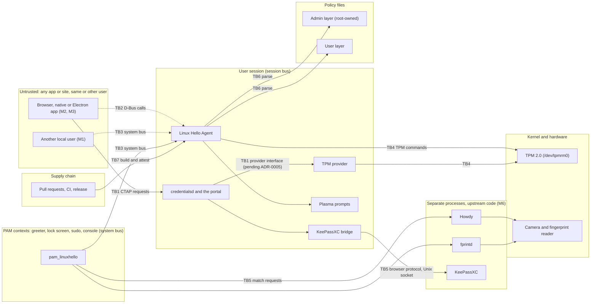

# Threat model

What Linux Hello protects, from whom, across which boundaries, and which security property answers each threat. The properties and their tests are in [properties.md](properties.md); this note says why each one exists. It starts from the threat list in [Arc42 section 8](https://github.com/LinuxHello/architecture/blob/main/arc42/08-crosscutting-concepts.md#threats-to-design-against) and the security model in [SECURITY.md](../../SECURITY.md).

**Status: draft, written before any authentication code exists.** It models the architecture as documented, not as built. Where the design has not decided something that a threat depends on, this note says so under [Open questions](#open-questions) instead of assuming an answer. Nothing here has been reviewed by anyone but the author.

## Assets

| Id | Asset | Why it matters | Where it lives |
| :-- | :-- | :-- | :-- |
| A1 | The per-user TPM root key and its PIN authorisation | Every device-bound passkey hangs off it ([ADR-0003](https://github.com/LinuxHello/architecture/blob/main/adr/0003-destructive-reset.md)) | TPM 2.0; used by the TPM provider and the Agent |
| A2 | Device-bound passkey private keys | Signing with one is logging in as the user | TPM, as children of A1 |
| A3 | Portable passkeys | Same, and they sync | KeePassXC, reached over its browser protocol |
| A4 | The PIN | The root secret the user types | The user's head; briefly in the PAM module or a prompt |
| A5 | Biometric templates | Cannot be changed if stolen | Howdy and fprintd; Linux Hello never copies them |
| A6 | The unlock state of a session | Proof that this session may use A2 without asking again | Agent, backed by a TPM policy session |
| A7 | The routing policy (default, user and admin layers) | Decides which methods and providers each context may use | Files under `/etc/linuxhello/policy.d/` (root-owned) and `/var/lib/linuxhello/users/<uid>/policy.toml` (the Agent's state, written only by the Agent over D-Bus, [ADR-0018](https://github.com/LinuxHello/architecture/blob/main/adr/0018-user-policy-layer.md)) |
| A8 | The authentication decision at login, lock screen and `sudo` | A wrong "yes" is a bypass | PAM stack |
| A9 | Which method a person is using, and when | Tells an observer who is authenticating | Agent method-state signals |
| A10 | The audit log | The only evidence after an incident | journald |
| A11 | The source, the CI and the release files | A poisoned build is every other asset lost | GitHub, the release workflow |

## Actors

| Id | Actor | Capability assumed |
| :-- | :-- | :-- |
| U1 | The desktop user | Legitimate. Can also make mistakes: forgets the PIN, approves a prompt they did not read |
| U2 | The administrator | Legitimate. Writes the admin policy layer; authorises a trust-chain reset |
| M1 | Another local user | An unprivileged account on the same machine; can use the system bus, read world-readable files and run processes |
| M2 | A malicious process in the user's session | Same user id as U1, including a sandboxed or Electron app and a compromised browser; can use the session bus and read the user's files |
| M3 | A malicious website or relying party | Controls a web page, its origin claims and the requests the browser forwards |
| M4 | A person with physical access | Holds the machine locked or powered off; may show a photograph, a mask or a fingerprint cast to a sensor |
| M5 | A supply-chain attacker | Publishes a malicious crate, action or release, or submits a pull request |
| M6 | A compromised upstream component | credentialsd, KeePassXC, Howdy, fprintd, xdg-desktop-portal or Plasma returns false answers |

**Out of scope**, as in [SECURITY.md](../../SECURITY.md#scope): an attacker with root or a kernel compromise on the running machine, unless Linux Hello claims to resist it; a biometric false match inside the documented error rate of the sensor or Howdy; a user's denial of service against their own session. Not addressed by the design today either, and therefore not claimed: tampering with the firmware or boot chain, and binding the root key to boot measurements (PCRs).

## Trust boundaries

| Id | Boundary | What crosses it | What the far side must not assume |
| :-- | :-- | :-- | :-- |
| TB1 | Application or browser to credentialsd, and credentialsd to a provider | CTAP requests with an origin and a relying party id | That the origin is honest: an unprivileged client's claim is never trusted, only what the portal verified |
| TB2 | A process in the session to the Agent's D-Bus API | Method calls: unlock state, PIN change, enrolment, reset | That the caller is who it says. Peer credentials are checked on every call |
| TB3 | A PAM context to the Agent over the **system bus** | Method state, session unlock | That the bus is private: any local user can reach the system bus. Spike [0007](https://github.com/LinuxHello/architecture/blob/main/spikes/0007-pam-dbus-method-state.md) found the system bus is the only one reachable in every PAM context |
| TB4 | Agent or provider to the TPM | TPM commands, policy sessions, signatures | Nothing: the TPM is the one place that enforces the PIN and holds the keys |
| TB5 | Linux Hello to Howdy, fprintd and KeePassXC | Match requests and results; passkey assertions | That a helper's answer is true. A helper's "match" is a claim that must still satisfy a TPM policy. All three are GPL and sit across a process boundary ([licence boundary](https://github.com/LinuxHello/architecture/blob/main/adr/0002-licence-lgpl-3-or-later.md)) |
| TB6 | Policy files to the parser | TOML text | That the file is well formed, owned by root (admin layer) or written by the owner |
| TB7 | Contributors and dependencies to the release | Source, crates, actions | That a dependency is honest |

There is no network boundary inside Linux Hello: none of its processes needs the network. Remote parties reach it only through a browser and credentialsd.

## Entry points

| Entry point | Container | Untrusted input | Boundary |
| :-- | :-- | :-- | :-- |
| Agent D-Bus API | Agent | Method arguments, caller identity | TB2, TB3 |
| credentialsd provider interface (does not exist at v0.3.1; [ADR-0005](https://github.com/LinuxHello/architecture/blob/main/adr/0005-provider-path.md)) | TPM provider, KeePassXC bridge | CTAP/CBOR requests, origin, relying party id | TB1 |
| PAM entry points `pam_sm_authenticate`, `pam_sm_open_session` | pam_linuxhello | The PAM conversation, the user name | TB3, TB5 |
| KeePassXC browser protocol | KeePassXC bridge | Messages from the KeePassXC side | TB5 |
| Howdy and fprintd results | pam_linuxhello | Match verdicts, error codes | TB5 |
| Policy files | Agent | TOML | TB6 |
| `linuxhello-ctl` | CLI | Arguments, the invoking user | TB2 |
| Plasma prompts | Plasma integration | Method state from the Agent; the user's PIN, typed | TB2 |
| Pull requests, workflows, dependencies | CI and release | Code and configuration | TB7 |

## Threats

The columns *Actor*, *Entry point* and *Asset* use the ids above. *Answered by* names the properties in [properties.md](properties.md); a property marked **implemented** there has a passing test today, the rest are placeholders.

| Id | Threat | Actor | Entry point | Asset | Answered by |
| :-- | :-- | :-- | :-- | :-- | :-- |
| T1 | **Caller impersonation.** An app on D-Bus claims to be a browser, or asserts another site's origin | M2, M3 | Agent API, provider interface | A2, A3 | P-01, P-02 |
| T2 | **Confused deputy.** A request for one relying party is answered with another's credential | M2, M3 | Provider interface | A2, A3 | P-03 |
| T3 | **Unlock bypass.** A biometric match is accepted without a TPM policy being satisfied, or unlock is a flag in a daemon | M2, M4, M6 | PAM, Agent API | A1, A2, A6 | P-06, P-07 |
| T4 | **Key exfiltration.** Private key material leaves the TPM or KeePassXC, or lands in the Secret Service, a log or an error | M2, M6 | Provider interface, logs | A2, A3 | P-08, P-09, P-10, P-13 |
| T5 | **Silent use.** A passkey signs without the user knowing | M2, M3 | Provider interface | A2 | P-11 |
| T6 | **PIN guessing.** Online guessing through the Agent or PAM, or a PIN compared in software instead of by the TPM | M1, M2, M4 | PAM, Agent API | A1, A4 | P-12, P-14 |
| T7 | **Lockout of another user.** One user's failed PIN attempts exhaust a shared TPM lockout counter and block everyone (see [Open questions](#open-questions)) | M1 | Agent API, PAM | A1, A8 | P-14 |
| T8 | **Biometric spoofing.** A photograph, mask or cast passes a sensor | M4 | Howdy, fprintd | A5, A6 | P-06 limits the damage: a match alone releases no key. Resisting the spoof itself is Howdy's and fprintd's job (out of scope above, except a bypass of IR anti-spoofing) |
| T9 | **Policy weakening.** A user loosens an admin setting; a malformed, unreadable or other-user-writable file is accepted | M1, M2 | Policy files | A7 | **Implemented**: the policy table in [README](README.md#routing-policy) |
| T10 | **Method-state disclosure.** Method state broadcast on the system bus tells every local user who is authenticating and how | M1 | System bus | A9 | P-04, P-05 |
| T11 | **PAM fails open.** The Agent is down or answers with an error, and the module reports success; or success is reported for another user | M1, M2 | PAM entry points | A8 | P-20, P-21 |
| T12 | **Stale unlock.** An unlock outlives its timeout or the screen lock | M4 | Agent | A6 | P-15 |
| T13 | **Reset abuse.** The account password unlocks keys, or a reset runs without authentication | M1, M2, M4 | Agent API, `linuxhello-ctl` | A1, A2 | P-17, P-18, P-19 |
| T14 | **PIN change loses keys.** Changing the PIN re-creates the root key, or leaves the old PIN working | U1 | Agent API | A1, A2 | P-16 |
| T15 | **Parser exploit.** A malformed CTAP/CBOR request, KeePassXC message, D-Bus message or policy file | M2, M3, M6 | Every parser | All | P-22, P-23; the policy parser is **implemented** (fuzz target `policy_parse`); no `unsafe` outside two audited modules is **implemented** |
| T16 | **Process snooping.** Another process reads the Agent's or a provider's memory, or opens the TPM | M2 | The kernel's process interfaces | A1, A2, A4 | P-25 |
| T17 | **Exfiltration over the network.** A compromised daemon sends material out | M2, M6 | Sockets | All | P-26 |
| T18 | **Unconfined daemon.** A daemon runs without its AppArmor profile | M2 | Start-up | All | P-24 |
| T19 | **No evidence.** An unlock, signature, PIN change or reset leaves no record, or the record holds a secret | All | journald | A10 | P-27, P-13 |
| T20 | **Supply chain.** A malicious crate, workflow or release file | M5 | CI, release | A11 | **Implemented**: the quality gate, `cargo-deny`, `cargo-audit` and release provenance ([README](README.md#properties)) |
| T21 | **A helper lies.** Howdy, fprintd or KeePassXC returns a false match or assertion | M6 | Match results, KeePassXC protocol | A3, A6 | P-06, P-07 (a helper's answer alone releases nothing) |

## Open questions

These are things a threat above depends on and the design has not settled. Each blocks the property named, not the whole list.

1. **How does a biometric match satisfy a TPM policy?** The invariant says it does; no note says by which TPM mechanism, nor who holds the authorisation. T3, T8 and T21 are only as strong as that answer. Blocks P-06 and P-07. Needs a spike or an ADR.
2. **Is the TPM's dictionary-attack lockout shared across users?** My understanding of the TPM 2.0 design is that the lockout counter is global to the TPM, so many failed authorisations by one user could lock out all. I have not checked this against the specification or the TPM in use, so it is an assumption. If it holds, the Agent must stop a user's repeated failures before they reach the TPM (the policy already has `lockout_attempts` and `lockout_minutes`). Blocks P-14.
3. **Which bus does the Agent serve the PAM module on, and under what bus policy?** Spike 0007 says the system bus and calls for an ADR. Blocks P-04 and P-05.
4. **How is the origin of a browser request verified?** The provider interface does not exist yet ([ADR-0005](https://github.com/LinuxHello/architecture/blob/main/adr/0005-provider-path.md)), and spike [0006](https://github.com/LinuxHello/architecture/blob/main/spikes/0006-browser-webauthn-portal.md) found that no stock browser calls the portal and that the credentialsd extension passes the origin from the page side. Blocks P-01 for the browser path.
5. **Is the root key bound to boot measurements?** Not in the design. A stolen powered-off machine with a modified boot chain is not modelled.

## Review

This model is a draft by the lead agent. The maintainer owns it ([GOVERNANCE.md](../../GOVERNANCE.md)); the threats and the out-of-scope list need his review, and an outside reviewer should see it before anyone relies on Linux Hello ([Arc42 section 8, control 6](https://github.com/LinuxHello/architecture/blob/main/arc42/08-crosscutting-concepts.md#controls)).

See [index](README.md).
