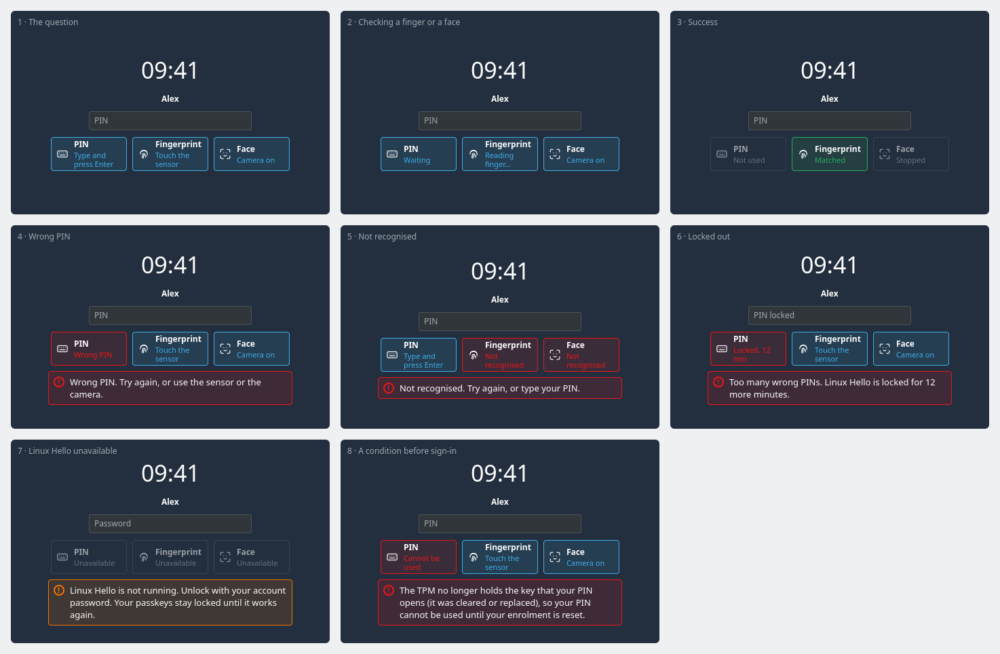

# Plasma integration

This folder holds the parts of Linux Hello that a person sees on a KDE Plasma desktop: the prompt on the login and lock screens, the notification after sign-in, and later the page in System Settings. They are written in QML, the language Plasma's screens are made of. None of them starts a program to do Linux Hello's work: they get their information from the Linux Hello Agent, the system service that runs the fingerprint, the face and the PIN ([ADR-0026](https://github.com/LinuxHello/linux-hello-architecture/blob/main/adr/0026-clients-reach-the-agent-directly.md)).

| Folder | What it is | State |
| :-- | :-- | :-- |
| [`auth-prompt/`](auth-prompt/) | The Auth Prompt, the shared QML module every Linux Hello screen imports | Built and tested with a fake Agent; not yet connected to the real one |
| [`autostart/`](autostart/) | The entry that starts `linuxhello-ctl notify` after sign-in, for the PIN expiry and severe conditions | Built |

## The Auth Prompt

When a person signs in, Linux Hello runs the fingerprint, the face and the PIN at the same time, and the first that succeeds wins. The Auth Prompt shows that on screen: one *tile* per method with its state ("Touch the sensor", "Wrong PIN", "Matched"), and *cards* under the tiles for what the person should read, such as "Too many wrong PINs. Linux Hello is locked for 12 more minutes." The login screen, the lock screen and the in-session prompt all import the same module, so they look and speak alike. The states it shows are those drawn on the lock-screen and login-screen boards of the [UI proposals](https://github.com/LinuxHello/linux-hello-architecture/blob/main/notes/ui-proposals-2026-11.md).

The picture below shows the module in all eight states of the lock-screen board, drawn by the demo from a fake Agent. Each frame stands for a lock screen; the tiles and the red, orange or blue cards are the module, and the field above them only shows the placeholder the module asks the screen to use.



What to notice: the field's placeholder changes with the state ("PIN locked", "Password"), and only the methods that can be used in the attempt get a tile.

### How it is put together

The module is the folder `auth-prompt/io/github/LinuxHello/AuthPrompt/`, imported as `io.github.LinuxHello.AuthPrompt`:

| File | What it does |
| :-- | :-- |
| `AuthPrompt.qml` | Puts the tiles and the cards together for one attempt |
| `MethodTile.qml` | One method: icon, name, one line of detail, coloured by its state |
| `ConditionCard.qml` | One line to read, coloured by its severity: red for an error, orange for a warning, blue for information |
| `prompt.js` | Works out every tile and card from the Agent's state. All the wording is here, so every screen says the same |

The module reads one object, the Agent's state for the attempt, which the screen hands it as `agentState`. The fields are listed at the top of `prompt.js`: whether the Agent answers, which methods the attempt can use and which run now, how the attempt ended and why, the seconds left of a lockout, the conditions the Agent reports, and how each method ended. The module itself calls nothing. A screen feeds it, today from the fake Agent of the demo and the tests (`auth-prompt/demo/states.js`), later from a part that listens to the Agent's signals on D-Bus (not built yet).

### Running the tests and the demo

Both need Qt 6 with Qt Quick; the desktop test VM of the workstation repository has it.

```sh
plasma/auth-prompt/tests/run.sh
```

first checks that the module's sources start no program and open nothing (`tests/starts-no-program.sh`, the rule of ADR-0026), then runs the Qt Quick tests in `tests/tst_prompt.qml` without a screen. They check what the module says in each state of the boards. It needs `qt6-declarative-dev-tools` and `qml6-module-qttest` on Ubuntu.

```sh
QT_QPA_PLATFORM=offscreen python3 plasma/auth-prompt/demo/render.py states.png
```

draws the eight states into a picture, the one above. It needs PySide6 (`python3-pyside6.qtquick` on Ubuntu).

The tests do not run in this repository's CI yet, because its runners have no Qt.
