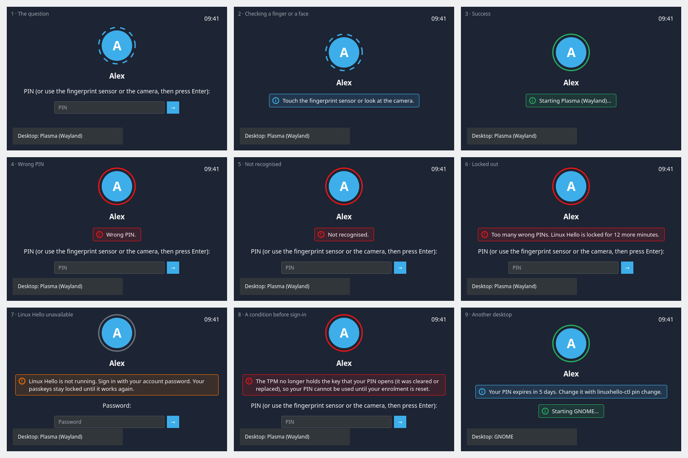

# The Linux Hello Greeter

The Linux Hello Greeter is Linux Hello's own login screen: the screen where a person picks their account, signs in with a PIN, a fingerprint or their face, and the desktop starts. Most login screens (SDDM on KDE Plasma, GDM on GNOME) answer the sign-in questions themselves and show at most one line of what Linux Hello says, so a person cannot see that Linux Hello asks for a PIN, that the PIN was wrong, or that Linux Hello is locked for 12 minutes. This greeter shows all of it. This page says what the greeter shows, how it is built, and how to install and test it.

**State:** built and tested in the desktop test VM of the workstation repository, with Linux Hello's PAM module, Plasma and Weston (see *Tests*). It is part of the prototype; no package ships it yet.

## How it fits together

The greeter works with *greetd*, a small login service. greetd runs PAM (Pluggable Authentication Modules, the Linux system that asks modules such as Linux Hello's `pam_linuxhello` whether a person may sign in) and starts the chosen desktop as that person. It leaves the screen to a separate program, the *greeter*, and talks to it over a socket: it passes each of PAM's questions and lines with its kind (a visible or a hidden question, an information line or an error line) and waits for the answer ([greetd-ipc(7)](https://man.archlinux.org/man/greetd-ipc.7.en)). Linux Hello writes only that greeter. Because greetd starts the desktop from its session file, the greeter starts Plasma, GNOME, Weston or any other installed desktop. The decision is [ADR-0016's amendment of 2026-11-21](https://github.com/LinuxHello/linux-hello-architecture/blob/main/adr/0016-prompt-hosts.md), and how it is built is [ADR-0028's amendment of 2026-11-22](https://github.com/LinuxHello/linux-hello-architecture/blob/main/adr/0028-plasma-agent-backend.md).

greetd runs the greeter under *cage*, a compositor that shows one program on the whole screen, as greetd's own user `_greetd`. Its configuration, `/etc/greetd/config.toml`, says so in one line: `command = "cage -s -- linuxhello-greeter"`.

The greeter has three parts:

| Part | What it does |
| :-- | :-- |
| `src/main.rs`, the program `linuxhello-greeter` | Starts Qt and opens the window `Main.qml`. It holds no logic and no `unsafe` code. |
| `qml/`, the window | `Main.qml` wires the screen to greetd and to the Linux Hello Agent; `Greeter.qml` is the screen; `greeter.js` works out the cards, the ring and the next step from greetd's state, and holds the greeter's own wording. |
| The `Greetd` and `AgentLink` objects of the [Agent Link](../linuxhello-plasma/) plugin | Speak greetd's protocol and ask the Linux Hello Agent, the system service that runs the methods, whether it runs. QML can do neither by itself. |

The coloured cards come from the shared [Auth Prompt](../auth-prompt/) module. Neither the greeter nor its plugin starts a program: greetd starts the desktop after the greeter closes ([ADR-0026](https://github.com/LinuxHello/linux-hello-architecture/blob/main/adr/0026-clients-reach-the-agent-directly.md)).

## What it shows

The picture below shows the greeter in the nine states of the login board D of the [UI proposals](https://github.com/LinuxHello/linux-hello-architecture/blob/main/notes/ui-proposals-2026-11.md), drawn from a fake greetd. Read it left to right, top to bottom: the question, a finger or face being checked, success, a wrong PIN, not recognised, a lockout, Linux Hello not running, a condition before sign-in, and a line after sign-in with another desktop.



What to notice: the question above the field is PAM's own text, a red card is an error line from PAM and a blue card an information line, and the ring around the picture turns red after an error and green on success.

The greeter follows a few rules:

- **The sign-in starts at once.** When the window opens, the sign-in of the first person starts, so Linux Hello can run the fingerprint and the face before anything is typed.
- **The field shows only while PAM asks.** While Linux Hello waits for a finger, PAM asks nothing, and the screen shows the information line instead.
- **After a refused answer, the next attempt starts at once.** A refusal without an answer, as on a lockout, waits for the person to press "Try again", so the greeter does not loop.
- **Linux Hello not running is a warning.** The greeter asks the Agent (`Ping`) when it opens and every five seconds while there is no answer, and then says that the account password is needed.
- **Starting the desktop waits a moment,** so that "Starting Plasma (Wayland)…" and a line PAM sent after the sign-in, such as a PIN that expires soon, can be read.

The desktop menu at the bottom lists the session files in `/usr/share/wayland-sessions` and `/usr/share/xsessions`. A desktop of the X window system is offered only when `startx` is installed, because it needs an X server, and is started through it. With more than one account, small pictures above the large one choose the person.

## Install

```sh
scripts/prototype/install.sh --greeter
```

builds the greeter and the plugin, installs them (`/usr/bin/linuxhello-greeter`, the QML modules in `/usr/lib/linuxhello/qml`, the window in `/usr/share/linuxhello/greeter`), sets greetd's command and adds Linux Hello to `/etc/pam.d/login`, which greetd's PAM file includes. It needs greetd, cage and Qt 6 and names the Ubuntu packages if one is missing. [docs/prototype.md](../../docs/prototype.md) has the details, and `scripts/prototype/uninstall.sh` undoes it.

## Tests

```sh
plasma/linuxhello-greeter/tests/run.sh
```

first checks that the window's QML and JavaScript start no program and open nothing (`tests/starts-no-program.sh`), then runs the Qt Quick tests in `tests/tst_greeter.qml` without a screen: what the greeter shows in each of the nine states, and what it asks greetd to do (answer, start again, start the desktop). It needs `qt6-declarative-dev-tools`, `qml6-module-qttest` and `qml6-module-qtquick-controls` on Ubuntu; CI runs it in the `plasma` job. The Rust tests of the protocol run with `cargo test` in `plasma/`.

```sh
QT_QPA_PLATFORM=offscreen python3 plasma/linuxhello-greeter/demo/render.py states.png
```

draws the picture above; it needs PySide6 (`python3-pyside6.qtquick`).

In the desktop test VM, with the real greetd, cage, Agent and PAM module, the greeter showed the question, a wrong PIN, a lockout, Linux Hello not running and a cleared TPM, and started Plasma and Weston. The states with a finger or a face (2 and 5) need a sensor and a camera, which the VM does not have, and the PIN-expiry line (9) needs a PIN rule that expires; those three are tested with the fake greetd only.
